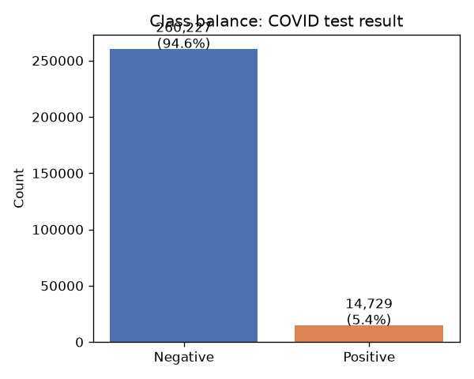
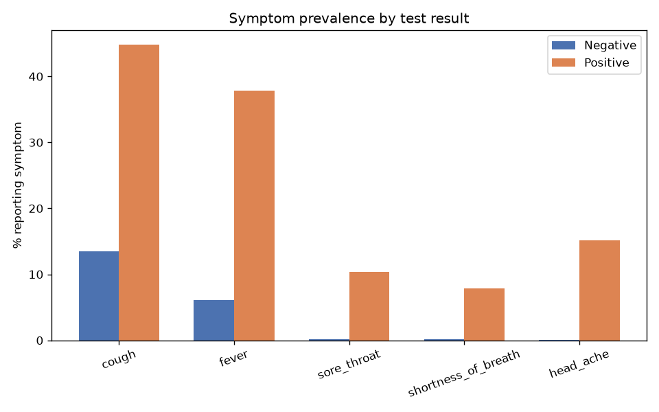
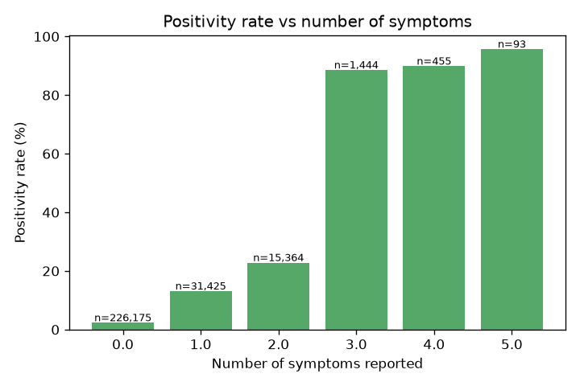
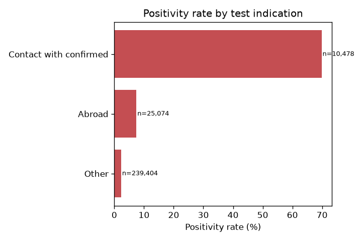
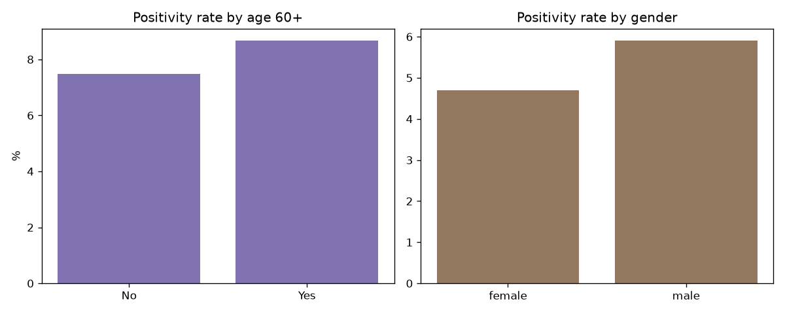
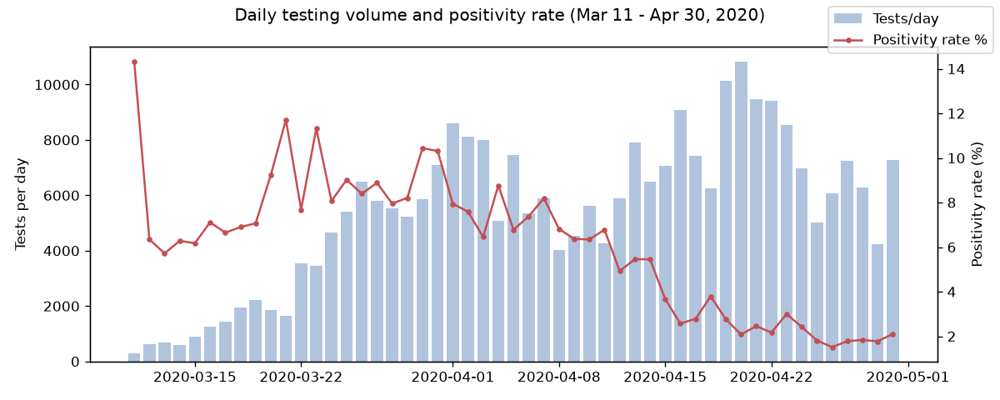
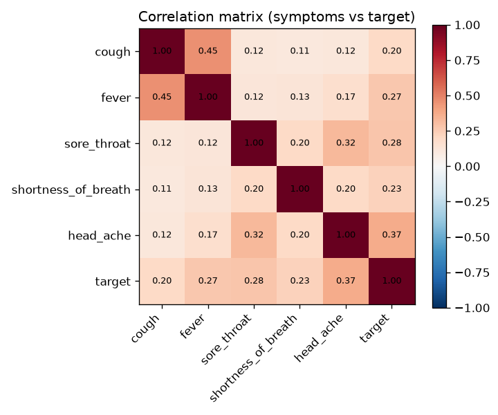

# Exploratory Data Analysis — COVID-19 Symptom Testing Dataset

Dataset: `corona_tested_individuals_ver_006.english.csv`
Source: Israeli Ministry of Health, as used in [Zoabi et al., "Machine learning-based prediction of COVID-19 diagnosis based on symptoms"](https://www.nature.com/articles/s41746-020-00372-6.pdf) and the [covidpred repo](https://github.com/nshomron/covidpred/tree/master).

## 1. Shape and columns

- **278,848 rows × 10 columns**, one row per individual test.
- `test_date`: daily records from **2020-03-11 to 2020-04-30** (51 distinct days).
- Columns:
  - 5 binary symptom indicators: `cough`, `fever`, `sore_throat`, `shortness_of_breath`, `head_ache`
  - `corona_result`: `negative` / `positive` / `other`
  - `age_60_and_above`: `Yes` / `No` / missing
  - `gender`: `male` / `female` / missing
  - `test_indication`: `Other` / `Abroad` / `Contact with confirmed`

## 2. Missing data — the biggest data-quality issue

| Column | Missing | % of rows |
|---|---|---|
| `age_60_and_above` | 127,320 | **45.7%** |
| `gender` | 19,563 | 7.0% |
| `cough` / `fever` | 252 each | 0.1% |
| `sore_throat` / `shortness_of_breath` / `head_ache` | 1 each | ~0% |

**`age_60_and_above` is missing for nearly half the dataset.** This is the single biggest modelling decision to make early:
- Tree-based models (XGBoost/LightGBM, which the original paper used) handle missing values natively — simplest option, matches the paper's approach.
- If using a model that needs complete data (logistic regression, sklearn's default trees), you'll need an explicit "missing" category or imputation, and should check whether missingness itself is informative (it may correlate with test period/location rather than being random).

The 5 symptom columns and `test_indication` are essentially complete and need no imputation.

## 3. Target variable: `corona_result`

- `negative`: 260,227 (93.3%)
- `positive`: 14,729 (5.3%)
- `other`: 3,892 (1.4%) — inconclusive/pending results

**Decision:** dropped the 3,892 `other` rows (not a prediction target), leaving **274,956 rows** for a binary task.

**This is a strongly imbalanced classification problem: ~5.4% positive.** Accuracy alone will be a misleading metric — plan to use ROC-AUC / PR-AUC / recall-at-fixed-precision, and consider class weighting or threshold tuning. (This matches the paper, which reports AUC rather than accuracy.)

## 4. Symptom prevalence vs. test result

| Symptom | % among negatives | % among positives |
|---|---|---|
| cough | 13.5% | 44.8% |
| fever | 6.1% | 37.8% |
| head_ache | 0.06% | 15.2% |
| sore_throat | 0.14% | 10.4% |
| shortness_of_breath | 0.15% | 7.9% |

Every symptom is markedly more common in positive cases, but **cough and fever are far more prevalent overall** (reported by 15% and 8% of everyone tested) than the other three (<1% each). This asymmetry is a strong signal but also means sore_throat/shortness_of_breath/head_ache are rare, high-signal features — worth keeping even though they're sparse.

## 5. Number of symptoms is a strong, almost monotonic predictor

| # symptoms reported | n rows | Positivity rate |
|---|---|---|
| 0 | 226,175 | 2.3% |
| 1 | 31,425 | 13.1% |
| 2 | 15,364 | 22.8% |
| 3 | 1,444 | 88.6% |
| 4 | 455 | 89.9% |
| 5 | 93 | 95.7% |

There's a **sharp jump at 3+ symptoms** (22.8% → 88.6%), suggesting symptom *count* (not just individual flags) is a highly useful engineered feature, and that the relationship is non-linear — supports using tree-based models or explicit interaction/count features for linear ones.

## 6. `test_indication` is the single most predictive feature

| Indication | n rows | Positivity rate |
|---|---|---|
| Other | 239,404 | 2.3% |
| Abroad | 25,074 | 7.5% |
| Contact with confirmed | 10,478 | **69.8%** |

Known contact with a confirmed case raises positivity rate ~30x over the baseline. This is a much stronger signal than any individual symptom — **make sure to include it as a feature**, and be aware it may dominate feature-importance rankings, potentially masking the pure "symptoms-only" signal the paper is specifically trying to isolate (their stated goal is a symptom-only screening tool, so check whether they exclude this field — you may want to report model performance both with and without it).

## 7. Age and gender

- Age 60+: 8.7% positive vs. 7.5% for under-60 (small effect, and only computable on the 54% of rows with known age).
- Male: 5.9% positive vs. female: 4.7% (small but consistent effect).

Both effects are real but modest compared to symptoms and test indication — useful secondary features, not primary drivers.

## 8. Testing volume and positivity rate over time

- Average ~5,400 tests/day, rising over the period as testing capacity scaled up.
- Daily positivity rate ranged from **1.5% to 14.3%**, declining over the 7 weeks — consistent with Israel's first-wave curve flattening across March–April 2020.
- **Implication for modelling:** since prevalence drifts over time, a simple train/test split should probably be time-aware (e.g. train on earlier weeks, test on later ones) rather than fully random, to get a realistic estimate of how the model would perform going forward. A random split risks leaking the same base-rate into train and test and overstating performance.

## 9. Correlations between symptoms and target

- All symptom-symptom correlations are positive but modest (0.11–0.32) — symptoms co-occur somewhat but aren't redundant.
- Correlation with target: `head_ache` (0.37) > `sore_throat` (0.28) > `fever` (0.27) > `shortness_of_breath` (0.23) > `cough` (0.20).
- Interesting: despite cough/fever being the *most prevalent* symptoms, they have the *weakest* individual correlation with the target among the five — their predictive value comes more from volume of occurrence than discriminative power per se, whereas the rarer symptoms (head_ache, sore_throat) are rarer but more specific to positive cases.

## Summary — modelling recommendations

1. **Binary target:** drop `other` results → 274,956 rows, 5.4% positive. This is the setup the original paper uses.
2. **Handle `age_60_and_above` missingness (45.7%)** explicitly — either use a tree model that natively supports NaNs, or add a "missing" indicator category.
3. **Expect severe class imbalance** — evaluate with AUC/precision-recall/recall, not raw accuracy; consider class weights.
4. **`test_indication` and symptom count are the two strongest features** found in EDA. Decide early whether `test_indication` is in-scope (it's not a "symptom" and may not reflect what a self-screening tool user would know about themselves).
5. **Use a time-based split** (not random) given the clear temporal drift in positivity rate, to get an honest estimate of generalisation.
6. Minimal feature engineering already looks valuable: a `n_symptoms` count feature and the raw symptom/indication/demographic flags should be enough to approach the paper's reported performance with a gradient-boosted tree model (XGBoost/LightGBM), matching their methodology.

---
*Generated from `eda.py` / `eda2.py`. Plots saved in `eda_output/`.*
