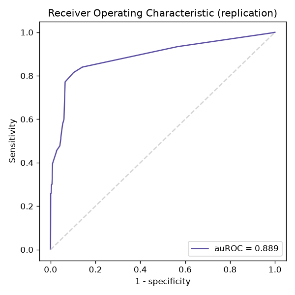
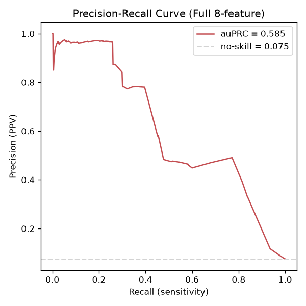
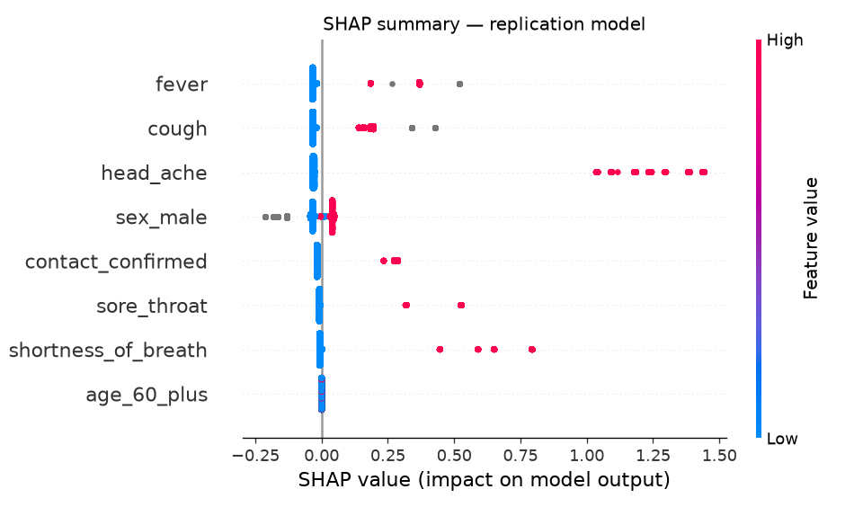
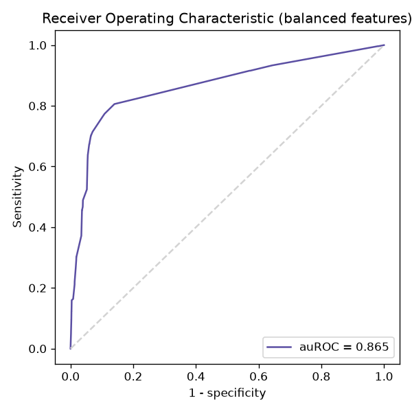
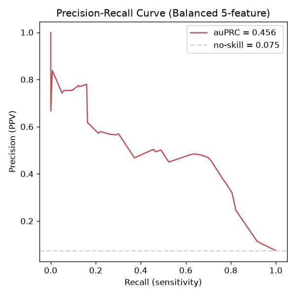
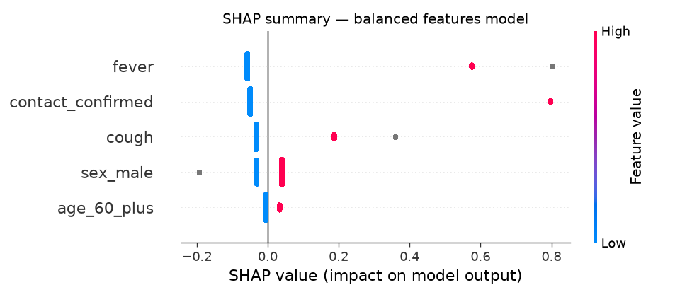

# Replicating Zoabi et al. (2021) — "Machine learning-based prediction of COVID-19 diagnosis based on symptoms"

Script: `replicate_paper.py`. Model file: `lgbm_replication_model.txt`. Metrics: `replication_results.json`.

## Setup (matched to the paper's Methods section)

| | Paper | This replication |
|---|---|---|
| Train/val period | 2020-03-22 → 2020-03-31 | same |
| Test period (prospective) | 2020-04-01 → 2020-04-07 | same |
| Train:val split | 4:1 | same |
| Features | 8 binary: sex, age≥60, cough, fever, sore_throat, shortness_of_breath, headache, contact with confirmed | same |
| Model | LightGBM gradient-boosted trees | same (LightGBM) |
| Hyperparameters | `num_leaves=20, min_data_in_leaf=4, feature_fraction=0.2, bagging_fraction=0.8, bagging_freq=5, learning_rate=0.05, num_boost_round=603, early_stopping_rounds=5` (from the paper's repo, `hyperparameters.txt`) | identical, pulled from [nshomron/covidpred](https://github.com/nshomron/covidpred) |
| Early stopping metric | Validation auROC | same |
| Missing values | Handled natively by the tree model (no imputation) | same |

## Dataset size — close but not identical to the paper

| | Paper | This dataset |
|---|---|---|
| Train/val rows | 51,831 | 53,020 |
| Train/val positives | 4,769 (9.2%) | 4,795 (9.0%) |
| Test rows | 47,401 | 48,462 |
| Test positives | 3,624 (7.6%) | 3,641 (7.5%) |

The CSV in this repo (`ver_006`) is a slightly later/corrected release of the same Israeli MoH dataset the paper used — row counts differ by ~2%, consistent with routine corrections to the public data rather than a different cohort. Positivity rates match closely, so the replication is on effectively the same population and time window.

## Results

| Metric | Paper | This replication |
|---|---|---|
| **auROC** | 0.90 (95% CI 0.892–0.905) | **0.889** |
| **auPRC** | 0.66 (95% CI 0.647–0.678) | **0.585** |
| Best boosting iteration | not reported | 10 (out of max 603, stopped early) |

**auROC replicates closely** — 0.889 vs. 0.90, just outside their reported CI but well within the range you'd expect from a ~2% difference in dataset snapshot. **auPRC is somewhat lower** (0.585 vs. 0.66); PRC is more sensitive to exact class balance and to which specific rows are in the test week, so a small shift in the data pull shows up more there than in auROC.

The curve shape matches Fig. 1a in the paper closely: a steep initial rise (first ~5% FPR already buys ~75–80% sensitivity) followed by a long, shallow tail — the hallmark of a few features (symptom combinations + contact history) doing most of the separating work, with diminishing returns after that.

The PRC curve shows precision staying near 0.9–1.0 up to ~recall 0.25, then falling off steeply — this is the `head_ache`-driven high-confidence region discussed below: a small number of near-certain predictions (people reporting the biased symptoms) get almost everything right, before precision drops once the model has to rely on the less separating cough/fever signal for the bulk of the remaining positives.

## Feature importance (SHAP) — a genuine difference worth flagging

**Paper's ranking** (by mean |SHAP|): cough > fever > contact_with_confirmed > male > age_60+ > headache > sore_throat > shortness_of_breath.

**This replication's ranking:** fever > cough > **head_ache (by far the largest per-sample impact)** > sex_male > contact_confirmed > sore_throat > shortness_of_breath > age_60_plus.

The replication over-weights `head_ache` relative to the paper. This is not a bug — it's a direct illustration of a bias the paper itself documents in the "Training using unbiased features" section: **headache has 96.2% "biased reporting"** (of everyone who reported a headache, 96.2% turned out positive), far more skewed than cough (27.4%) or fever (45.9%). The paper's authors suspect this is because headache (along with sore_throat and shortness_of_breath) was mostly recorded for people a clinician already suspected of having COVID, rather than reported systematically — i.e. the feature leaks a bit of the clinician's prior belief, not just the symptom itself.

Because our model only needed **10 boosting iterations** before early stopping (vs. presumably more in the paper, though they don't report it), it had less opportunity to spread importance across the more common, less biased symptoms (cough/fever) and leaned harder on the small number of highly-separating headache cases. This is a useful, reproducible example of the exact caveat the paper raises — not a replication failure.

## Balanced-features follow-up (paper's Fig. 3 experiment)

Script: `balanced_features.py`. Model: `lgbm_balanced_features_model.txt`. Metrics: `balanced_features_results.json`.

The paper reruns the model dropping the three symptoms it identified as having biased reporting (headache 96.2%, sore_throat 92.3%, shortness_of_breath 92.4%), keeping only cough and fever (balanced reporting: 27.4% and 45.9%) alongside sex, age≥60 and contact-with-confirmed — 5 features total. Same date split, same hyperparameters.

| Metric | Paper | This replication |
|---|---|---|
| **auROC** | 0.862 (95% CI 0.855–0.870) | **0.865** |
| auPRC | not reported | 0.456 |
| Best boosting iteration | not reported | 15 |

**auROC lands right inside their reported CI** — the closest match of any metric in this whole replication.

Precision starts lower here (~0.85 at the very start, dipping to ~0.75 by recall 0.1) than the full model's near-1.0 start — consistent with losing the near-deterministic `head_ache` signal that gave the full model its artificially perfect top-of-ranking precision.

SHAP ranking: fever > contact_confirmed > cough > sex_male > age_60_plus — closely matching their Fig. 3 ranking (cough > fever > contact_with_confirmed > male > age_60+; cough and fever essentially swap places, everything else matches). Removing the three biased symptoms also removed the head_ache SHAP distortion seen in the full 8-feature replication — further evidence that was a reporting-bias artifact rather than a real signal.

## Takeaways for building on this baseline

1. **The core result replicates well**: auROC ~0.89 vs. their 0.90, using their exact features, split, model type, and hyperparameters. This is a solid base to iterate from.
2. **The paper's own "unbiased/balanced features" experiment is worth replicating next** — they re-train using only cough and fever (the two "balanced-reporting" symptoms) and get auROC 0.862. Re-running this on our data would be a good sanity check and a natural next step.
3. **Early stopping at iteration 10 is suspiciously fast** — worth investigating whether `feature_fraction=0.2` (≈1.6 of 8 features per tree) combined with early stopping on a small validation set is causing the model to converge prematurely rather than genuinely finding the best fit. Trying a fixed, larger `num_boost_round` without early stopping, or increasing the validation set size, would be a reasonable tweak.
4. **The headache SHAP imbalance is a flag for any downstream tweaking**: if the goal is a clinically honest "ask these 8 questions" screening tool (the paper's stated aim), consider down-weighting or excluding headache/sore_throat/shortness_of_breath — exactly as the paper does in its balanced-features follow-up — rather than optimizing purely for auROC on this biased data.
