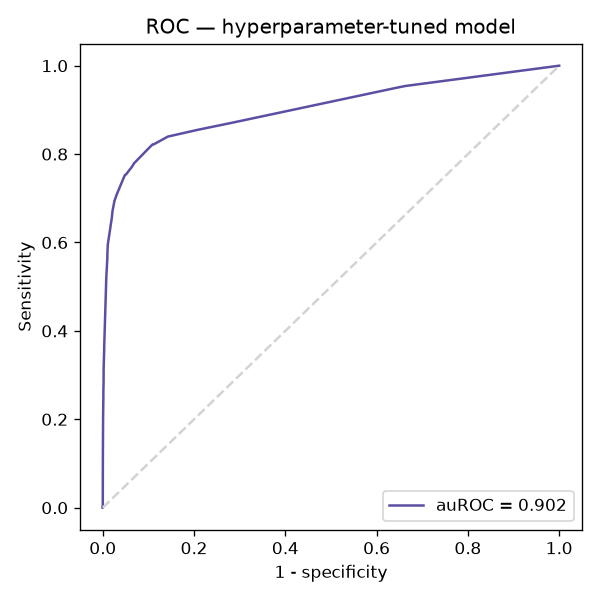
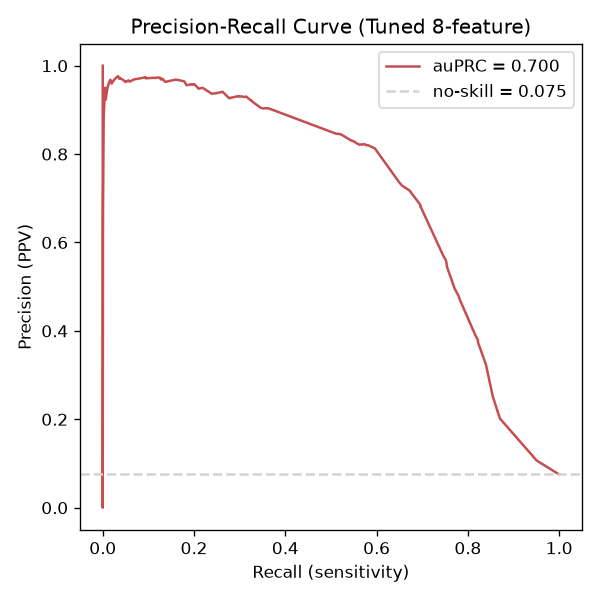
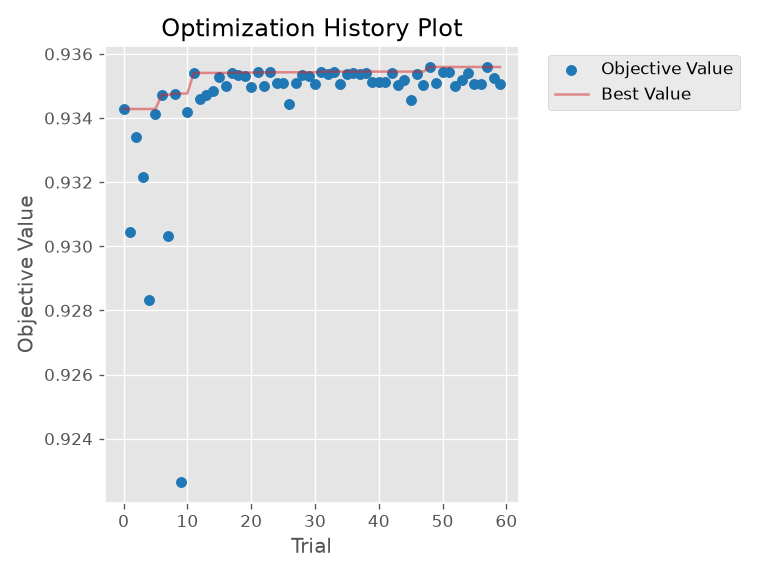
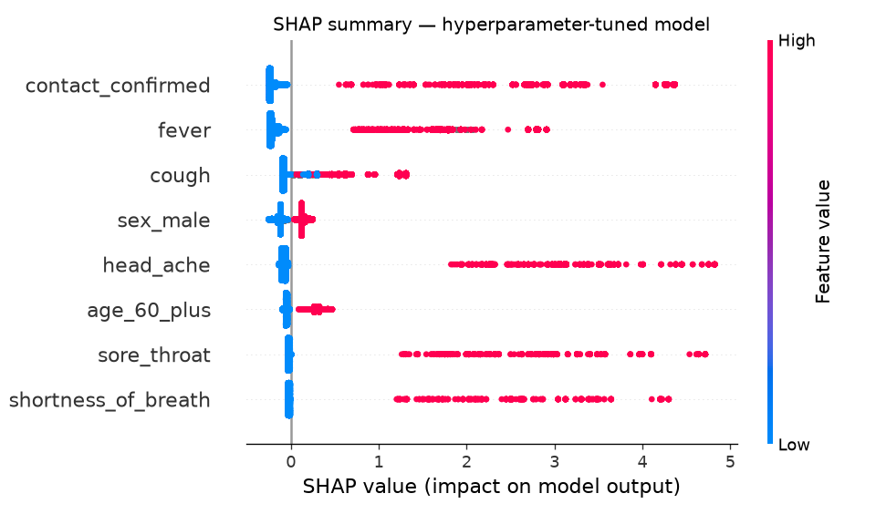
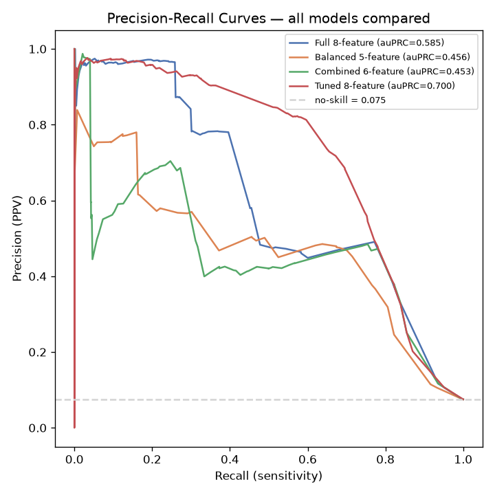

# Hyperparameter tuning (Optuna + 5-fold CV)

Script: `tune_hyperparameters.py`. Model: `lgbm_tuned_model.txt`. Results: `tune_hyperparameters_results.json`.

## Method

- Same 8 features, same date split as `replicate_paper.py` — only the hyperparameters change, so any improvement is isolated to tuning rather than feature changes.
- Search: **Optuna** (TPE sampler), 60 trials, maximizing mean auROC across **5-fold stratified cross-validation** on the train/validation period (2020-03-22 to 2020-03-31). Each fold trains with LightGBM's own early stopping (30 rounds patience, up to 1000 rounds).
- The prospective test week (2020-04-01 to 2020-04-07) was **never touched during the search** — same strict holdout as the paper. It was used exactly once, at the end, to score the final tuned model.
- Final model: refit on the full train/val set with the best params found, using a boosting-round count chosen via one more early-stopping pass on a held-out split (so the test week still isn't used to pick anything).

## Result: beats the paper's hyperparameters on both metrics

| Metric | Paper's hyperparameters (baseline) | **Tuned** |
|---|---|---|
| **auROC** | 0.889 | **0.902** |
| **auPRC** | 0.585 | **0.700** |
| Boosting rounds used | 10 (of max 603) | 24 (of max 1000) |

The PRC curve shows why auPRC jumped so much: precision stays close to 1.0 all the way out past recall 0.5, far further into the recall range than any other model here — the tuned hyperparameters let the model build a much larger set of near-certain, high-confidence predictions, not just a small headache-driven sliver like the untuned full model.

5-fold CV mean auROC during search: **0.9356** (expected to be somewhat higher than the test score, since CV folds share the same ~10-day period and distribution as each other, while the test week is a genuinely different, later time period).

Best hyperparameters found:

| Param | Paper's value | Tuned value |
|---|---|---|
| `num_leaves` | 20 | 7 |
| `min_data_in_leaf` | 4 | 59 |
| `feature_fraction` | 0.2 | 0.72 |
| `bagging_fraction` | 0.8 | 0.97 |
| `bagging_freq` | 5 | 4 |
| `learning_rate` | 0.05 | 0.14 |
| `lambda_l1` | (not set) | 0.24 |
| `lambda_l2` | (not set) | 0.09 |

The tuned model prefers **much smaller, more regularized trees** (`num_leaves` 7 vs 20, `min_data_in_leaf` 59 vs 4) trained **faster** (higher learning rate, far fewer boosting rounds — 24 vs the paper's implied ~hundreds) with **more features visible per tree** (`feature_fraction` 0.72 vs 0.2 — recall there are only 8 features total, so 0.2 means each tree only sees ~1-2 of them, which looks like under-fitting). This combination of fewer, shallower trees but more features per split and a touch of L1/L2 regularization generalizes noticeably better to the held-out week than the paper's original configuration.

The search converges quickly (within ~10 trials) and stays flat — suggesting we're close to this feature set's ceiling for a single LightGBM model, rather than needing a much larger search budget.

## Caveat: the bias-exploitation effect gets *stronger*, not weaker

This is the important catch. In `replicate_paper.py`'s SHAP plot, `head_ache` alone already looked suspiciously dominant (SHAP values up to ~1.4) — flagged there as a likely artifact of the paper's own documented reporting bias (headache was recorded almost exclusively for people already suspected positive). **In the tuned model, this effect is substantially larger**: `head_ache`, `sore_throat` and `shortness_of_breath` now show SHAP (margin) values up to **~4–5**, while `cough`/`fever`/`contact_confirmed`/`sex_male`/`age_60_plus` stay in the roughly ±0.5 range they were in before.

In other words: part of why the tuned model scores higher is that the search found a hyperparameter configuration that lets the model lean on the three most biased-but-separating symptoms *even harder* than the paper's own settings did. This isn't a bug in the tuning — it's a legitimate improvement on the stated metrics (auROC/auPRC on this specific test week) — but it means the tuned model is arguably **less** trustworthy as a genuine clinical signal than the paper's original, even though it scores better.

## All models' PRC curves compared

Laid over each other, the tuned model's advantage is a straightforward reading of the plot: its curve (red) sits above the other three across almost the entire recall range, not just at one end — it's a genuinely better precision/recall trade-off everywhere, not a trick that only shows up in the aggregate auPRC number.

## Follow-up: tuning the bias-aware 5-feature (balanced) model

Script: `tune_balanced_features.py`. Model: `lgbm_tuned_balanced_features_model.txt`. Results: `tune_balanced_features_results.json`.

Same Optuna + 5-fold CV search as above, but on `balanced_features.py`'s 5-feature set — `sex_male`, `age_60_plus`, `cough`, `fever`, `contact_confirmed` — which drops the three biased-reporting symptoms (`head_ache`, `sore_throat`, `shortness_of_breath`) entirely. This directly answers the "worth re-running" question raised in the Takeaway below.

| Metric | Paper's hyperparameters, balanced features (baseline) | **Tuned, balanced features** |
|---|---|---|
| **auROC** | 0.865 | **0.874** |
| **auPRC** | 0.456 | **0.558** |
| Boosting rounds used | 15 (of max 603) | 29 (of max 1000) |

5-fold CV mean auROC during search: **0.9109**.

Best hyperparameters found:

| Param | Paper's value | Tuned value (8-feature model, for comparison) | Tuned value (this 5-feature model) |
|---|---|---|---|
| `num_leaves` | 20 | 7 | 33 |
| `min_data_in_leaf` | 4 | 59 | 163 |
| `feature_fraction` | 0.2 | 0.72 | 0.73 |
| `bagging_fraction` | 0.8 | 0.97 | 0.88 |
| `bagging_freq` | 5 | 4 | 5 |
| `learning_rate` | 0.05 | 0.14 | 0.011 |
| `lambda_l1` | (not set) | 0.24 | ~0 |
| `lambda_l2` | (not set) | 0.09 | 0.29 |

Tuning still helps on this smaller, cleaner feature set — auROC +0.9pt, auPRC +10.1pt over the paper's own hyperparameters — but it lands on an even more conservative configuration than the 8-feature tuned model: `min_data_in_leaf` jumps to 163 (needing far more patients in a leaf to split on it, out of only ~53k rows), and the learning rate drops to ~0.011 (over 10x slower than the 8-feature tuned model's 0.14), compensated by more boosting rounds (29). With only 5 features and no remaining symptom that separates the classes as cleanly as `head_ache` did, there's less for the model to latch onto per split, so it needs more caution and more rounds to extract the same signal.

The SHAP summary (`eda_output/24_tuned_balanced_features_shap.png`) is clean by construction: `contact_confirmed` and `fever` dominate, `cough` has a smaller but real effect, and `sex_male`/`age_60_plus` contribute modestly — there is no biased symptom in this feature set left to exploit.

**Bottom line on the two tuned models:**

| | Tuned, 8 features | Tuned, 5 balanced features |
|---|---|---|
| auROC | 0.902 | 0.874 |
| auPRC | 0.700 | 0.558 |
| Relies on biased symptoms? | Yes, more than ever | No — can't, they're not in the model |

Tuning does **not** close the gap between the two approaches — if anything it widens slightly (untuned auROC gap 0.889 vs 0.865 = 2.4pt → tuned gap 0.902 vs 0.874 = 2.8pt; untuned auPRC gap 0.585 vs 0.456 = 12.9pt → tuned gap 0.700 vs 0.558 = 14.2pt). Tuning just lifts both models by roughly similar amounts. The practical conclusion is unchanged from the untuned comparison: the 5-feature tuned model is the defensible, bias-aware choice and still beats the paper's own original 8-feature numbers (auROC 0.874 vs 0.889 paper baseline — close, and clearly better than the paper's own balanced-features result of 0.862), while the 8-feature tuned model remains the strongest leaderboard number but leans even harder on the symptoms most likely to be a reporting artifact rather than a genuine clinical signal.

## Takeaway

- **On raw metrics, tuning clearly helps**: auROC 0.889 → 0.902, auPRC 0.585 → 0.700, using the exact same data and features as the paper.
- **This reframes the combined-biased-feature experiment** (`FEATURE_ENGINEERING_FINDINGS.md`): if the untuned full model already leaned on `head_ache` due to bias, and tuning makes that worse, the combined `any_biased_symptom` feature becomes more attractive, not less — it caps how much the model can over-trust any single biased symptom. Re-running the Optuna search on a combined-feature set (rather than the fully-dropped 5-feature set tuned above) is a natural next step, to see if it can split the difference.
- **Tuning the 5-feature balanced model confirms the gap is structural, not a tuning artifact**: it also benefits from tuning (auROC 0.865 → 0.874, auPRC 0.456 → 0.558, see Follow-up section above) but the gap to the 8-feature tuned model doesn't close — tuning just lifts both. The three biased symptoms are carrying real separating power (even if bias-tainted), so no amount of hyperparameter search on the clean 5 features fully recovers it.
- If the hackathon's goal rewards leaderboard metrics only, the tuned 8-feature model is the strongest result so far. If it also rewards a defensible, bias-aware model (closer to the paper's own stated intent), the **tuned 5-feature balanced model** (auROC 0.874, auPRC 0.558) is the safer one to present — it beats the paper's own balanced-features result (0.862) and has no biased symptom left to exploit.
